# Entity–relationship diagram

Source of truth: `src/server/db/schema/*.ts` → `drizzle/*.sql`. Every mutable planning/tracking table also has
`created_at`, `updated_at`, `version`, `updated_by` (omitted below for readability).

```mermaid
erDiagram
    day ||--o{ plan_option : "has options A, B…"
    day ||--o{ block : "day_id (denormalized)"
    plan_option ||--o{ block : "contains"
    day |o--o| plan_option : "chosen_option_id"
    day ||--o{ proposal : "agent proposals"
    block |o--o{ task : "related_block_id"
    habit ||--o{ habit_log : "one per date"
    device ||--o| passkey : "fingerprint"
    device ||--o{ push_subscription : ""
    device |o--o{ auth_attempt : ""

    day {
        uuid id PK
        date date UK "local YYYY-MM-DD"
        day_status status "draft|chosen|edited|closed"
        uuid chosen_option_id FK
        text notes
        text calls_summary
        smallint weekly_gym_done
        smallint weekly_gym_target
        smallint review_energy "1-5"
        smallint review_mood "1-5"
        text review_text
        timestamptz reviewed_at
        timestamptz closed_at
    }
    plan_option {
        uuid id PK
        uuid day_id FK
        text label "A-Z, unique per day"
        text title
        text description
        int order
    }
    block {
        uuid id PK
        uuid option_id FK "(option_id, day_id) composite FK"
        uuid day_id FK
        text start "HH:mm"
        text end "HH:mm, nullable"
        text title
        block_type type
        text detail
        jsonb lead "call only"
        block_source source "calendar|agent|user"
        text external_id "required if calendar"
        text external_url
        calendar_kind calendar "work|personal"
        block_status status "pending|done|skipped"
        timestamptz status_at
        call_outcome outcome "call only"
        text note
        bool locked
        text_array user_overrides "schedule fields"
        int order
    }
    proposal {
        uuid id PK
        uuid day_id FK
        jsonb payload "full PUT body"
        text reason
        proposal_status status "max 1 pending per day"
        int base_day_version
        timestamptz created_at
        timestamptz resolved_at
    }
    habit {
        uuid id PK
        text slug UK
        text name
        habit_kind kind "boolean|numeric"
        text unit
        int target_count
        habit_period target_period "day|week"
        block_type block_type "optional auto-log link"
        bool active
        int order
    }
    habit_log {
        uuid id PK
        uuid habit_id FK
        date date "unique with habit_id"
        bool done
        numeric value
        habit_log_source source
    }
    task {
        uuid id PK
        date date
        text title
        task_kind kind
        task_origin origin
        bool done
        timestamptz done_at
        uuid related_block_id FK
        int order
    }
    change_log {
        uuid id PK
        actor actor
        text entity
        uuid entity_id
        date date
        change_action action
        jsonb diff
        bool forced
        text request_id
        timestamptz at
    }
    webhook_outbox {
        uuid id PK "= batchId"
        date date
        jsonb payload
        webhook_status status "collecting|pending|sent|failed"
        smallint attempts
        timestamptz next_attempt_at
        smallint last_response_status
        text last_error
        timestamptz sent_at
    }
    idempotency_key {
        actor actor PK
        text key PK
        text method
        text path
        text request_hash
        int response_status
        jsonb response_body
        timestamptz created_at
    }
    app_user {
        uuid id PK
        bool singleton UK "always true"
        text pin_hash "argon2id"
        bytea webauthn_user_id
    }
    recovery_code {
        uuid id PK
        text hash "argon2id"
        timestamptz used_at
    }
    pin_reset_code {
        uuid id PK
        text hash
        timestamptz expires_at
        timestamptz used_at
    }
    device {
        uuid id PK
        text name
        text user_agent
        text session_hash UK "sha256"
        timestamptz last_seen_at
        timestamptz last_unlock_at
        timestamptz revoked_at
    }
    passkey {
        uuid id PK
        uuid device_id FK,UK
        text credential_id UK
        bytea public_key
        bigint counter
        text_array transports
    }
    auth_lockout {
        lockout_scope scope PK "device|global"
        text key PK
        int failed_count
        int lockout_count
        timestamptz locked_until
    }
    auth_attempt {
        uuid id PK
        auth_method method
        bool success
        text device_key
        uuid device_id FK
        text ip
        timestamptz at
    }
    push_subscription {
        uuid id PK
        uuid device_id FK
        text endpoint UK
        text p256dh
        text auth
        bool call_reminders
    }
```

