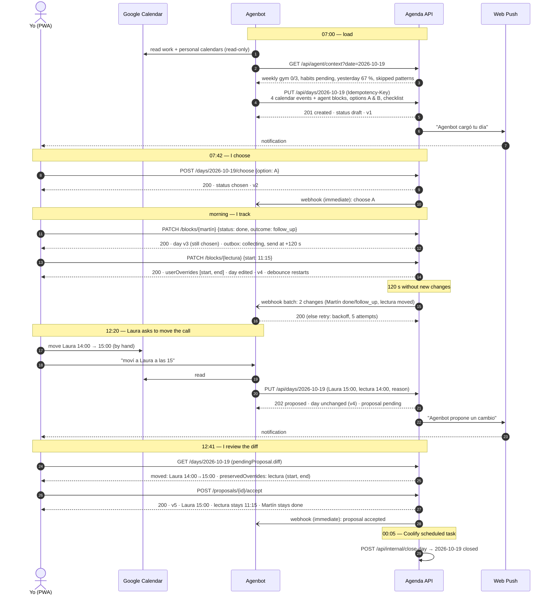
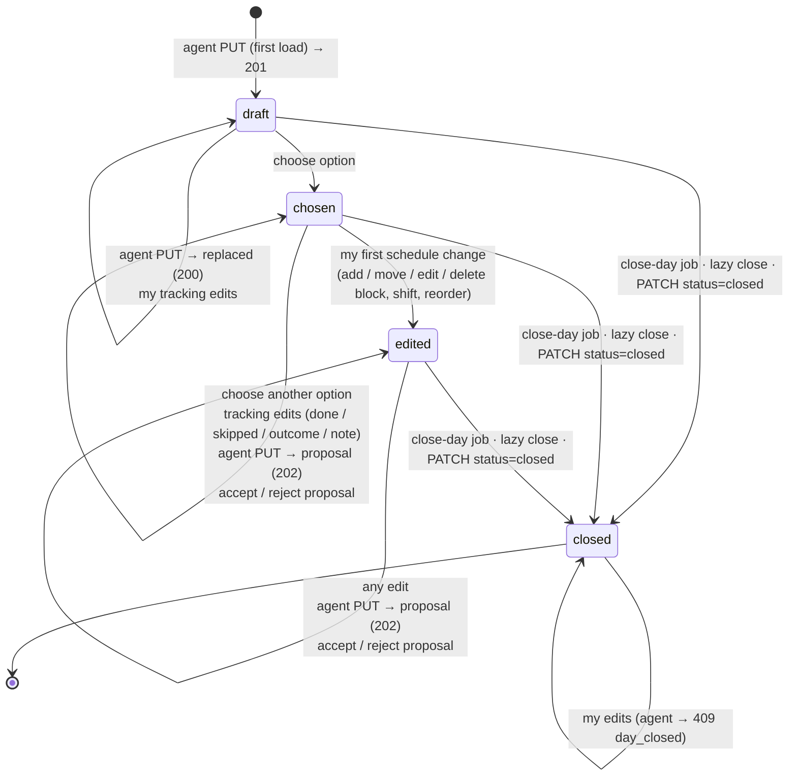
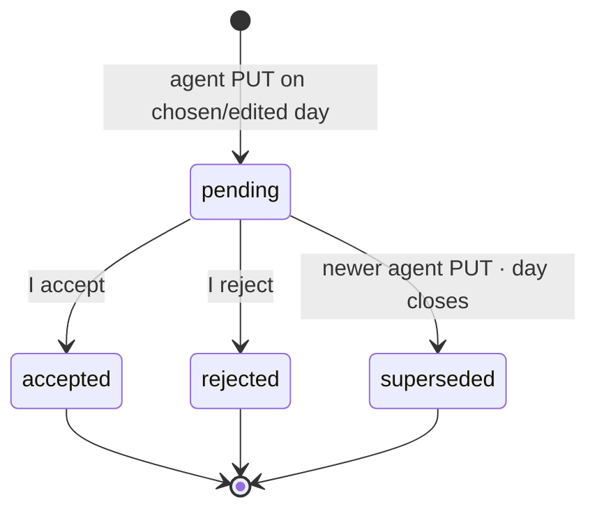

# Flows

Concrete requests and responses for every step: `docs/api-examples.md`. Contract: `openapi.yaml`.

## Daily flow (Monday 2026-10-19)

Alternatives: on **reject** the day is untouched and the webhook reports `proposal / reject`. If Agenbot sends another PUT
while a proposal is pending, the old one becomes `superseded`. If the cron is missed, the first read of the past day
closes it (lazy close).

## `Day.status`

| From | Event | Actor | To | Notes |
|---|---|---|---|---|
| — | `PUT /days/{date}` | agent | `draft` | 201 |
| `draft` | `PUT` | agent | `draft` | 200, replaced in place (tracking preserved on matched blocks) |
| `draft` | `POST choose` | user/agent | `chosen` | webhook immediately |
| `chosen` | `POST choose` (other label) | user/agent | `chosen` | not allowed once `edited` (409 `invalid_transition`) |
| `chosen` | schedule change by me | user | `edited` | tracking changes keep `chosen` |
| `chosen`/`edited` | `PUT` | agent | unchanged | 202, proposal; `?mode=force` applies immediately |
| `chosen`/`edited` | accept / reject | user | unchanged | |
| any open | close job (00:05), lazy close, `PATCH status=closed` | system/user | `closed` | `userOverrides` stop mattering |
| `closed` | any write | agent | — | 409 `day_closed` |
| `closed` | edits | user | `closed` | allowed (corrections, review) |

## `Proposal.status`

